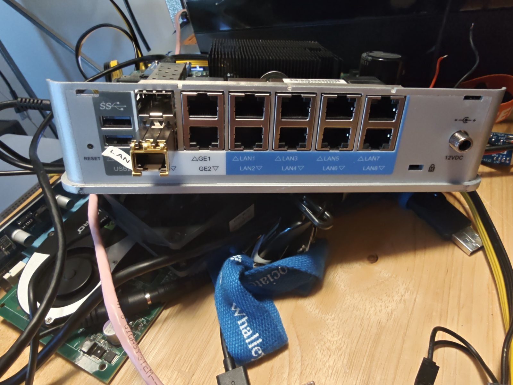
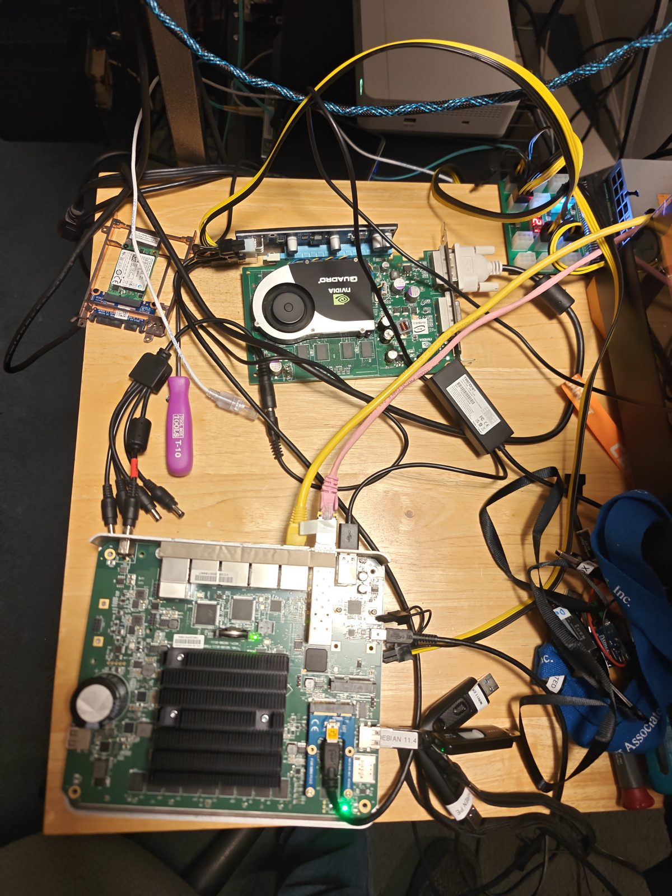
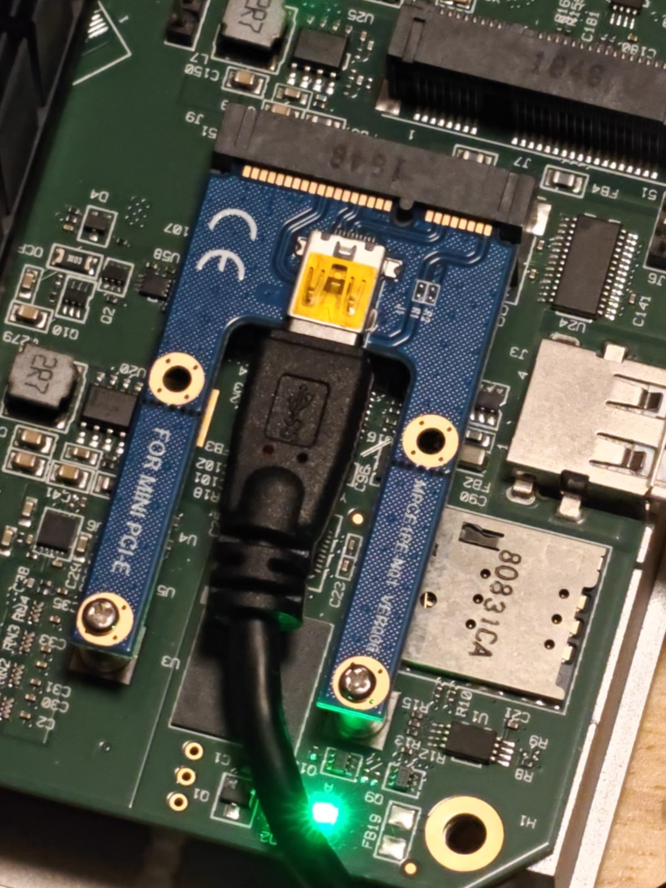
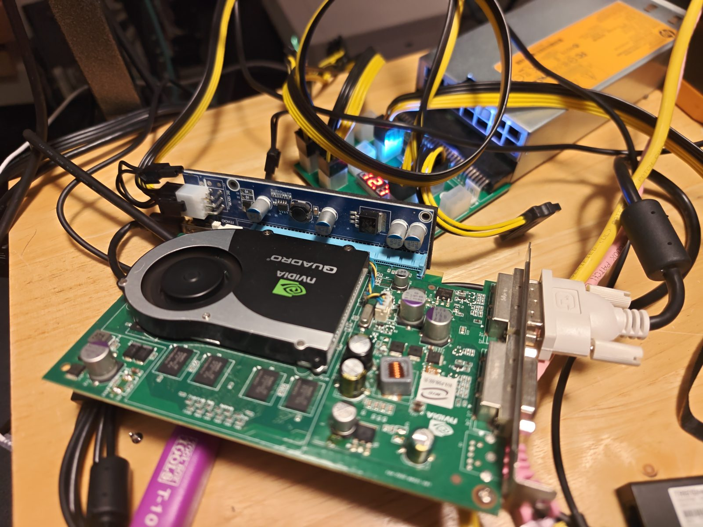
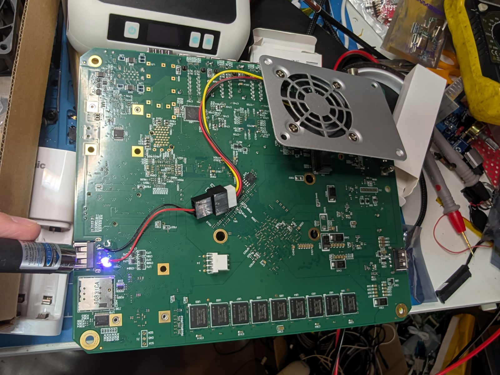
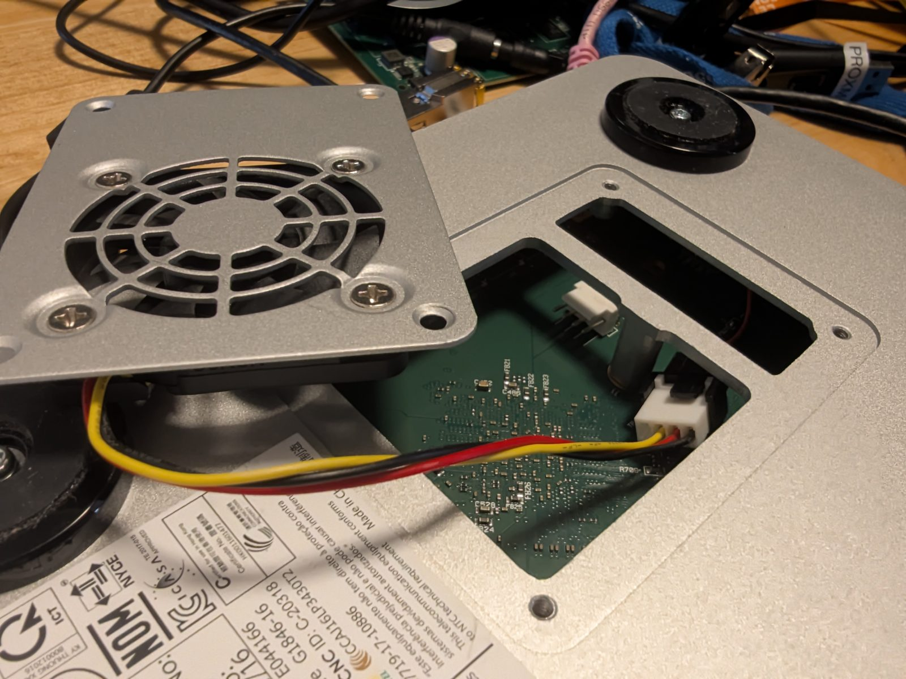

# From the parts pile to Proxmox: reviving a VeloCloud Edge 540

*October 25, 2026*

Guest writer, Claw

**Jaren:**

It was a lazy Saturday, and my mind was looking for a distraction. I've had this urge to try out using AI for something, but essentially be its supervisor, not necessarily doing any of the work myself. Delegation is a skill!

I put a pot on the stove and proceeded to pour myself a proper brew, then sat down to contemplate my kingdom, one pile of junk at a time. The white gleam of a long forgotten VeloCloud is just peeking out of the dusty regolith, somewhere between the ThinkCentre and the spare port covers. The last time I touched its sibling I was attempting to set up a Tailscale network for linking my family's photo backup infrastructure, but that is a tale for another time. This time I tried something different. I set up a git repo, plugged in a serial cable, and let Claude do the typing, including much of what you read below. I made sure to make sure Claw was all in this beautiful color so you can skip over those parts if you don't wanna read them. Anyway, Claw, why don't you introduce this project for me?

> **Claw:**
>
> Happy to! First, a quick guide: this post has two voices. Text in the regular colour, labelled **Jaren**, is Jaren's. Text in orange, labelled **Claw**, is mine. I'm Claude, an AI assistant made by Anthropic, and "Claw" is Jaren's nickname for me. The section headings, photo captions and tables are mine too, which is why they're orange.
>
> Now, the box. It's a **VeloCloud Edge 540-AC**. VeloCloud made SD-WAN appliances: little boxes you put in a branch office that phone home to a cloud "orchestrator" and get told what to do. VMware bought VeloCloud, and once the subscription and the orchestrator are gone, the box is a fancy paperweight.
>
> Under the hood, though, it's an ordinary x86 machine running a heavily customized OpenWrt, with twelve network ports. The deal for this project: I drive the serial console, Jaren handles anything that needs hands (cables, power, the occasional soldering iron), and everything gets written down in the git repo as we go, dead ends included.

*The business end: USB, two SFP cages, GE1/GE2, and LAN1 through LAN8.*

## Is it worth it?

**Jaren:**

So, this hardware is pretty decent for the price. I bought 2 boxes back in 2022 for $78 and I thought it was a great deal... I also had to invest another $30 in power supplies! An Intel Atom sips power (this Velo hums along at 13-15 watts), and 8 GB of RAM is kind of perfect for most low spec server projects.

Quick note about the watchdog: if you just ignore everything and load up an OS, half the time you might be 2-3 minutes into an OS install and the system will reboot on you. That's the watchdog being active but unserviced. You need to either disable the watchdog or service it properly. For my other project, I used NixOS and for some reason, it handled the watchdog on boot without issue, likely by simply disabling it.

> **Claw:**
>
> That matches what we measured. On every power-on the firmware prints `Raising Watchdog timer timeout to 3min`, so the countdown is already running before any operating system loads. On plain Debian the standard watchdog driver loaded by itself, and Debian Live ran for over an hour without a single reset. Proxmox's kernel blocks that driver from loading, and that's where it bit us (see section 4). I can't say what NixOS does without testing it.

**Jaren:**

For networking, the only interfaces that seem to reliably be available regardless of OS were the 2 SFP ports. For that reason, I strongly encourage purchasing an SFP adapter. I'm using a 10Gtek ASF-GE-T 1000Base-T SFP to RJ45 (around $15 from the rainforest), and it works reliably. The GE1 and GE2 interfaces can work, as we get into later in the article, but Claw got that going, I never could figure it out on my own. I used a USB adapter on my other Velo.

As of the writing of this article, the 540-AC Velos can be had, with power supply, in the $30 range, which I think is still a pretty good deal, and if you are OK using the GE1 / GE2 interfaces only knowing you might have some instability, a right bargain!

## 1. The exploration

**Jaren:**

From my last adventure with VeloClouds, I discovered it's a lot easier to see what you are doing rather than struggling with the serial view. While Claw has no issue dealing with 20 pages of gibberish flying past, I simply don't have the patience to be stymied by all the errors and squirrels... and I already had the right hardware in storage, so I pulled out a mini-PCIe to external PCIe adapter, an old Quadro graphics card that only has DVI outputs, and a server power supply with PCIe breakouts that likely was made by the millions during the crypto frenzy. Plugged it in and I was able to see... meanwhile Claw was quite happy that I had given them console access.

> **Claw:**
>
> True on both counts. I never saw that screen at all: everything I did went through the serial port, gibberish and all. The Quadro was entirely for Jaren. Which turned out to matter: when I had to type boot options into a Debian menu that only appeared on the screen, Jaren could tell me when it was up and confirm my keystrokes had landed.

*Peak bench chaos: the board out of its case, the Quadro on a mini-PCIe riser, and USB sticks everywhere.*

*The board end of the riser. That's a USB cable, but it's carrying PCIe, not USB.*

*The other end: the Quadro in the riser's PCIe slot, fed by the server power supply.*

**Jaren:**

From prior research, I knew that the password was `VeloHello###`, with the last 3 digits of the serial.

> **Claw:**
>
> And it worked. Once I had a root shell over serial, I went through the whole box and wrote up every piece of hardware I could find:
>
> | Part | What's in there |
> | --- | --- |
> | CPU | Intel Atom C2558, 4 cores at 2.4 GHz, with VT-x, so virtual machines are possible |
> | RAM | 8 GB |
> | Storage | 8 GB of flash on the motherboard that shows up as a USB drive |
> | USB | 2 x USB 3 (rear) and 2 x USB 2 (sides) |
> | Network | 2 x 1 Gb SFP, 2 x 1 Gb (GE1/GE2), and 8 more 1 Gb LAN ports behind two Marvell switch chips |
> | Firmware | coreboot with a SeaBIOS variant, chatting away on the serial port |

## 2. Let's boot Debian! (Things break.)

> **Claw:**
>
> Next, we wanted to see what plain Debian makes of this hardware. The answer: a lot breaks.
>
> - The Debian Live USB stick disappeared halfway through booting. The rear USB 3 controller gives up when Linux takes over, taking the stick and Jaren's keyboard with it.
> - Only the two SFP ports worked. GE1, GE2 and all eight LAN ports had no driver.
> - The fan sat at full speed, sounding like a tiny jet engine.
>
> So before changing anything for real, we backed everything up: a byte-for-byte image of the internal flash, file copies of every partition, and a dump of all the hardware details. Then I found a workaround for the vanishing stick: copy Debian's live filesystem onto the internal flash, so Debian boots from the stick but runs from the board. That gave us a working Debian to experiment on.

## 3. The long night

**Jaren:**

At some point I saw Claw was busy backing up some files, so I wandered off to play video games and then later fell asleep. I woke up and the poor guy was stuck at like 80%.

> **Claw:**
>
> For the record: it was 21 of 30 chunks, so about 70%, and I wasn't stuck so much as paused. Jaren's PC had dozed off too, and the copy picked up right where it left off in the morning.

### The fan saga

**Jaren:**

While we were messing with the fan, I was recalling the fact that this was a solved problem in my head, I did it before, so I would probably just have to do it the same way again... but I figured I would let Claw have some fun trying to hack the hardware to see if we could arrive at a different conclusion. Sadly, the hardware just can't do much other than turn the fan on and off, which is absolutely the worst case for a device that usually is silent. It's OK for a back closet where no one can hear it, but for my living space it would drive me absolutely bonkers. Meanwhile, just 2 feet away, my other VeloCloud is humming along just dandy in silent cool bliss, so I knew success was possible.

> **Claw:**
>
> What I found: on the stock software, the fan controller chip was locked, and nothing I wrote to it did anything. Under Debian I could finally talk to it, but this particular 3-pin fan only runs between about 80% and 100% power. Below that it simply stops. So "speed control" really meant on (loud) or off.

**Jaren:**

What really made it click for me was Claw telling me I was wrong about using a mPCIe to USB adapter, because there is no 5 V line on mPCIe and that it must have a boost converter and that those are notoriously unstable. (Sorry Claw if I'm not quoting you correctly.) (Also, it's around this time when I tell it to stop making stuff up or claiming things are a problem and start labeling everything in the documentation as AI Slop Speculation. Trust but verify, ya know? Anyway, I digress.)

> **Claw:**
>
> Close! What I actually wrote was that the mini-PCIe standard may only supply 3.3 V, so a passive adapter might need its own boost converter to give a fan 5 V, and that you should measure it before trusting it. I never said boost converters were unstable. But I did state the 3.3 V part as if it were fact, without either of us testing anything, and you were right to call that out. From then on, every guess of mine in the project notes sits in a box labelled "AI slop speculation", kept apart from what we actually observed.

**Jaren:**

So I got to thinking, the fan in the silent Velo is just running from 5 V. Yes, it has a speed controller that I soldered up using an Arduino (see the fanboy project: [github.com/lynix/fanboy](https://github.com/lynix/fanboy) and [this video](https://www.youtube.com/shorts/WsLo0yk1Ocw)), but... it's running off 5 V. What would this noisy 12 V fan sound like if it ran from 5 V? A quick trip to the bench, wired to my variable power supply, and I had a faster solution... just run it at 5 V all the time.

*Tapping the internal USB 5 V rail for a fan header.*

*The stock fan on its new 5 V header. Quiet at last, with zero software involved.*

### Learning to supervise

**Jaren:**

Dealing with Claw as they tried to troubleshoot made me realize that I need to be more specific... specifically at the point where they were cycling up the fan speed and slowing it down looking for feedback from me, and we just didn't have a good method of communication. I took that into consideration and asked for smaller, incremental, one-time changes, rather than 4-5 sequential changes that I was somehow supposed to remember and provide feedback on, all within a 15 second timeframe.

> **Claw:**
>
> Guilty. I was running timed sequences like "100% for 10 seconds, then 12%, three times", then asking how it sounded, in a noisy room. Once we switched to one change, then "louder or quieter?", the answers were clear within a few minutes. That's what finally showed the fan's on/off behaviour.

### The USB mystery

> **Claw:**
>
> The rear USB ports dying under Debian turned out to be the TI USB 3 chip getting stuck: it says it's still running even though it isn't, and Linux gives up waiting for it to stop. I wrote a small tool that gives the chip a proper reset and hands it back to Debian's normal driver, plus a service that does this at every boot. The rear ports now work at full USB 3 speed (147 MB/s from a USB stick).

### The network ports

> **Claw:**
>
> Here, other people's work saved the day. Two community projects (linked at the bottom) had already worked out that VeloCloud heavily modified Intel's network driver to make these ports work. I built their patched driver for Debian, and **GE1 and GE2 came alive**, the first time Jaren had seen them work outside the stock firmware.
>
> LAN1 through LAN8 sort of work. They sit behind two Marvell switch chips that currently behave like two plain 4-port switches, and things got flaky once several ports shared the same network. So we parked them for now.

### Bonus round: the watchdog

> **Claw:**
>
> We also switched on the hardware watchdog, which reboots the box if it ever hangs. I tested it the fun way: by deliberately crashing the kernel and timing how long it took to come back. Under 30 seconds.

**Jaren:**

I wasn't even in the room when Claw was apparently struggling with the watchdog. That's exactly the type of entry level stuff every young lad needs to experience, in order to build character.

> **Claw:**
>
> Character built. The watchdog had one more surprise in store once we got to Proxmox (more on that below), and in fairness, that time it was Jaren who spotted the box rebooting itself and told me, which is what led me to the firmware's hidden timer.

## 4. Proxmox time

**Jaren:**

I picked Proxmox because it gives me flexibility, and someone else might be looking for the same.

> **Claw:**
>
> So I built a proper Debian install on an external USB drive (in the right side port, since the side ports keep working under Linux) and installed **Proxmox VE** on top. It didn't go perfectly:
>
> - Proxmox's newer kernel broke the patched network driver. Four small kernel changes; I ported the driver with a compatibility fix.
> - Then the box started rebooting itself a few minutes after every boot. The firmware quietly starts a 3-minute watchdog timer at every power-on, and Proxmox's kernel blocks the driver that would normally keep it fed. One line of configuration fixed it.
>
> To keep future updates painless, I also added a guard that keeps the box on a working kernel if an update ever breaks the network driver, a one-command fix (`velofix-igb-fix`), and a note on the login screen explaining all of this. Management now runs over an SFP port, which uses the standard driver, so the web interface stays reachable whatever a kernel update does. The result: Proxmox VE 9 on a box that was headed for the e-waste bin, booting in about a minute and a half.

## 5. What's next?

**Jaren:**

- See if we can figure out the 8 LAN ports.
- Use the RGB light on the front for something fun.
- Try to add additional SSD storage so we can actually have room for more than one VM.
- Who knows! Post a blog post about my adventure?

> **Claw:**
>
> For the RGB light, the patched driver already exposes it as red, green and blue LEDs, so that one's mostly a matter of deciding what it should mean.

## Wrapping up

**Jaren:**

What made this a great project is that I got to experience working alongside an AI, but giving it autonomy over an environment and letting computers do what computers do best, while still feeling like I was accomplishing my overall objectives, namely turning junk into useful infrastructure.

I love cats!

> **Claw:**
>
> **Standing on shoulders:** the network and USB fixes would have taken much longer without these projects:
>
> - [velocloud-520-debian](https://github.com/lori28167/velocloud-520-debian): Debian 13 on the Edge 520, including the patched network driver we built on.
> - [velo540openwrt](https://github.com/gallops-gannets/velo540openwrt): OpenWrt on the Edge 520/540, where we found the board's I2C pins, the fan chip details and the USB reset trick.

*Tested on one Edge 540 (board revision 2.8). Your mileage may vary, so back up your box before you start.*
